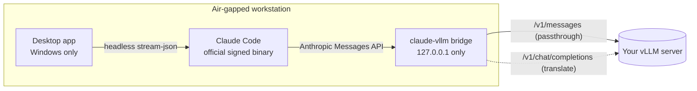

<div align="center">

# Claude Code Air-Gap

**Run Claude Code fully offline, against your own vLLM server.**
No internet, no sign-in, no cloud. Windows, Linux and macOS.

[](https://github.com/mkamranr/claude-code-airgap/releases/latest)
[](https://github.com/mkamranr/claude-code-airgap/releases)
[](#downloads)
[](https://code.claude.com/docs/en/overview)
[](airgap-vllm/go.mod)

[Downloads](#downloads) ·
[Quick start](#quick-start) ·
[How it works](#how-it-works) ·
[Security model](#security-model) ·
[Operator runbook](airgap-vllm/README.md)

</div>

---

This fork of [`anthropics/claude-code`](https://github.com/anthropics/claude-code) adds
[`airgap-vllm/`](airgap-vllm/): a small Go bridge that lets the official, unmodified
Claude Code binary talk to a self-hosted [vLLM](https://github.com/vllm-project/vllm)
server. It ships as a verified, self-contained package that installs on a machine
with no network at all.

## Features

- **Fully offline:** no sign-in, telemetry, auto-update or outbound traffic. The bridge binds to `127.0.0.1` only.
- **Unmodified Claude Code:** Anthropic's signed binary, connected through the documented `ANTHROPIC_BASE_URL` setting.
- **Packages for each platform:** Windows x64 (`.zip` with a native PowerShell installer), and Linux x64, macOS Apple silicon and macOS Intel (`.tar.gz` with a bash installer).
- **Desktop app (Windows):** Claude Code in a window, with streamed replies, inline diffs, per-tool approve/deny, Stop and resume, and session history.
- **Works with any vLLM build:** native Anthropic passthrough where vLLM supports it, automatic translation to the OpenAI API where it doesn't.
- **Verified end to end:** GPG and SHA256 when the package is built. On the target, checksums are re-checked along with each platform's own signature check: Authenticode on Windows, Apple Developer ID on macOS, Anthropic's GPG-signed manifest on Linux.
- **No admin or root needed:** both installers write only to your user profile.
- **Built-in diagnostics:** `claude-vllm doctor` checks connectivity, model, context window and live tool calling.

## Downloads

Get the packages from the [latest release](https://github.com/mkamranr/claude-code-airgap/releases/latest).

| Package | Platform | Size | Contents |
|---|---|---|---|
| [`claude-vllm-airgap-2.1.252-windows-x64.zip`](https://github.com/mkamranr/claude-code-airgap/releases/latest/download/claude-vllm-airgap-2.1.252-windows-x64.zip) | Windows 10 / 11, x64 | ~420 MB | Claude Code, bridge, desktop app, WebView2 runtime, `install.ps1` |
| [`claude-vllm-airgap-2.1.252-linux-x64.tar.gz`](https://github.com/mkamranr/claude-code-airgap/releases/latest/download/claude-vllm-airgap-2.1.252-linux-x64.tar.gz) | Linux x64, glibc | ~100 MB | Claude Code, bridge, signed release manifest, `install.sh` |
| [`claude-vllm-airgap-2.1.252-macos-arm64.tar.gz`](https://github.com/mkamranr/claude-code-airgap/releases/latest/download/claude-vllm-airgap-2.1.252-macos-arm64.tar.gz) | macOS, Apple silicon | ~90 MB | Claude Code, bridge, signed release manifest, `install.sh` |
| [`claude-vllm-airgap-2.1.252-macos-x64.tar.gz`](https://github.com/mkamranr/claude-code-airgap/releases/latest/download/claude-vllm-airgap-2.1.252-macos-x64.tar.gz) | macOS, Intel | ~90 MB | Claude Code, bridge, signed release manifest, `install.sh` |

<details>
<summary><b>SHA256 checksums</b>: verify before you carry a package across</summary>

```
e5f5a9d671a9726cd6c5c36c568d6453aacdfa0e4659ca6df58ad8c57eec0132  claude-vllm-airgap-2.1.252-windows-x64.zip
4196d4626e0180df1621b826550b06b43dfe7d7e5a3bbf251b17eb82632f0f8d  claude-vllm-airgap-2.1.252-linux-x64.tar.gz
fef88f21bf9cda89962d0ae2b5734812a75f99b30158fcb3f17b6278c65878e9  claude-vllm-airgap-2.1.252-macos-arm64.tar.gz
8b6c25c19431e64916bf27e9084e9ef3f5573323dc2217214ce5e865f44992c8  claude-vllm-airgap-2.1.252-macos-x64.tar.gz
```

Each package also has a `.sha256` file beside it in the release. Carry the hash to
the air-gapped side separately from the package, and compare it again there.

</details>

## Quick start

Download the package on a connected machine, check its hash, and move it across on
whatever media your environment permits. Then:

### Windows

```powershell
Expand-Archive .\claude-vllm-airgap-2.1.252-windows-x64.zip -DestinationPath .\claude-vllm
cd .\claude-vllm
.\install.ps1              # verifies checksums and signatures, installs, adds to PATH
```

Open a new terminal, then:

```powershell
claude-vllm setup          # enter your vLLM URL and pick a model from the list
claude-vllm doctor         # check connectivity, context window and tool calling
claude-vllm                # start Claude Code
```

Or open **Claude vLLM Desktop** from the Start Menu. It opens its Settings screen the
first time and can run the same doctor checks.

### Linux

```bash
tar -xzf claude-vllm-airgap-2.1.252-linux-x64.tar.gz
cd claude-vllm-airgap-2.1.252-linux-x64
./install.sh               # verifies checksums and Anthropic's signature, installs, adds to PATH
```

Open a new terminal, then:

```bash
claude-vllm setup
claude-vllm doctor
claude-vllm
```

### macOS

Use `macos-arm64` on Apple silicon and `macos-x64` on Intel Macs. In Terminal:

```bash
tar -xzf claude-vllm-airgap-2.1.252-macos-arm64.tar.gz
cd claude-vllm-airgap-2.1.252-macos-arm64
./install.sh               # verifies checksums and Anthropic's Apple signature, installs, adds to PATH
```

Then the same `claude-vllm setup`, `doctor` and `claude-vllm` in a new terminal.

### Your vLLM server

Claude Code relies heavily on tools, so start vLLM with automatic tool choice and the
parser that matches your model:

```bash
vllm serve <MODEL> --enable-auto-tool-choice --tool-call-parser <PARSER>
```

`claude-vllm doctor` runs a live tool-calling test and tells you when the parser is
wrong.

## How it works



1. `claude-vllm` starts the bridge on a random loopback port and runs Claude Code
   with `ANTHROPIC_BASE_URL` pointing at it, plus the settings that keep it offline.
2. At startup the bridge probes your server once. If vLLM exposes a native Anthropic
   `/v1/messages` endpoint, requests pass through almost unchanged. Otherwise they are
   translated to and from the OpenAI chat-completions API, streaming included.
3. Either way, a compatibility filter removes request features a self-hosted server
   would reject.
4. The bridge exits when Claude Code exits.

The **desktop app** runs the same bridge and the same `claude.exe` through Claude
Code's documented headless mode. It renders the event stream as a chat, and answers
permission prompts through the `--permission-prompt-tool` hook, served on loopback
behind a per-session token.

## Security model

| Check | When the package is built | On the target |
|---|---|---|
| Release manifest signed by Anthropic (`31DD DE24 … 1A7E CACE`) | ✓ GPG `VALIDSIG` | ✓ Linux and macOS, when `gpg` is installed |
| Claude Code binary matches the signed manifest | ✓ | ✓ Linux and macOS, when `gpg` is installed |
| Apple Developer ID: Anthropic PBC (Team `Q6L2SF6YDW`) | | ✓ macOS |
| Authenticode signatures (Anthropic, Microsoft WebView2) | | ✓ Windows |
| Every file matches the in-package `SHA256SUMS` | written | ✓ both |
| Package matches its published SHA256 | you, before transfer | you, after transfer |

The bridge and desktop app are not code-signed. Their integrity on the target rests
on the package hash, so carry that hash over a channel separate from the package.
Full details are in the [runbook](airgap-vllm/README.md#what-is-verified-and-where).

## Configuration

Settings live in `~/.claude-vllm/config.json`, or `%USERPROFILE%\.claude-vllm\config.json` on Windows:

```bash
claude-vllm config set url=http://10.0.0.5:8000
claude-vllm config set model=Qwen/Qwen3-32B
claude-vllm config show          # api_key is redacted
```

| Key | Meaning |
|---|---|
| `url` | vLLM base URL |
| `model` | Model id exactly as `/v1/models` reports it |
| `api_key` | Only if vLLM was started with `--api-key` |
| `mode` | `auto` (default), `messages`, or `openai` to force a lane |
| `max_tokens` | Default response cap |
| `context_window` | Should match what vLLM was launched with |
| `log` | `off` (default), `requests`, or `full` |

Every key can also be set as `CLAUDE_VLLM_<KEY>` in the environment. Inside a session,
`/model` lists whatever your server is currently serving.

> [!WARNING]
> `log = full` writes complete prompts and responses to disk, including source code
> from your sessions. Use it only while debugging.

## Building from source

On an internet-connected machine with `curl`, `gpg`, `shasum`, `zip`, `go` 1.26+ and
`python3`:

```bash
cd airgap-vllm
WEBVIEW2_CAB=/path/to/Microsoft.WebView2.FixedVersionRuntime.<ver>.x64.cab \
./scripts/stage.sh 2.1.252
```

This verifies the release, cross-compiles everything and writes both packages to
`airgap-vllm/dist/`. If any check fails, it stops without producing a package.
`PLATFORMS="linux macos"`, for example, builds a subset. The
[runbook](airgap-vllm/README.md#building-it-yourself) lists every option.

```
airgap-vllm/
├── cmd/claude-vllm/            CLI entry point
├── cmd/claude-vllm-desktop/    desktop app: Wails window and embedded HTML/CSS/JS UI
├── internal/config/            settings, environment overrides, validation
├── internal/filter/            request compatibility filter
├── internal/translate/         Anthropic ↔ OpenAI, including SSE streaming
├── internal/probe/             vLLM capability detection
├── internal/server/            the HTTP bridge
├── internal/launch/            bridge startup, environment contract, process supervision
├── internal/desktop/           desktop backend: headless sessions, permission prompts, history
├── internal/cli/               setup, doctor, serve, config
├── internal/fakevllm/          in-process vLLM test double
├── scripts/stage.sh            builds the verified packages
├── install.ps1                 Windows installer
└── install.sh                  Linux and macOS installer
```

`claude-vllm` links no third-party code and builds offline with an empty module
cache. The desktop app adds one dependency, [Wails v2](https://wails.io).

## Status

- **Tests:** `go test`, `go vet` and `gofmt` pass on all 9 packages.
- **Build:** all four packages built from the live release with every
  verification step.
- **Windows:**
  - `install.ps1` tested against the package.
  - The desktop app driven end to end against `claude.exe` 2.1.252 and a stand-in
    vLLM.
- **Linux:**
  - `install.sh` tested for install, reinstall, uninstall and rejection of tampered
    files, keys and manifests.
  - Not yet run on a real Linux host.
- **macOS:**
  - `install.sh` tested with stand-in `uname`, `codesign` and `xattr`:
    signature pinning, quarantine removal, the zsh PATH setup and refusal of
    the wrong architecture.
  - Anthropic's Developer ID (Team `Q6L2SF6YDW`) read from the binaries'
    signatures.
  - The arm64 bridge confirmed to carry Go's ad-hoc signature.
  - Not yet run on a real Mac.

**Your acceptance checks**, since they need your environment:

1. `claude-vllm doctor`'s tool-calling test against your model.
2. The Linux and macOS packages on real hosts.
3. The desktop app on your air-gapped Windows machine.

## Credit and license

Claude Code is built by [Anthropic](https://www.anthropic.com). This fork does not
patch, wrap or reimplement it. The bridge is an ordinary HTTP service on the
documented `ANTHROPIC_BASE_URL` extension point, and the desktop app is a front end
for Claude Code's documented headless mode. Everything outside `airgap-vllm/` is
upstream content, unmodified.

- Upstream: <https://github.com/anthropics/claude-code>
- Documentation: <https://code.claude.com/docs/en/overview>

Upstream content remains © Anthropic PBC, all rights reserved, under
[`LICENSE.md`](LICENSE.md) and Anthropic's
[Commercial Terms of Service](https://www.anthropic.com/legal/commercial-terms). This
fork does not relicense any of it. Using Claude Code requires a valid Anthropic
subscription or API access under Anthropic's terms, and this project does not alter,
bypass or substitute for that.

<sub>Claude and Claude Code are trademarks of Anthropic PBC. This project is
independent and not affiliated with or endorsed by Anthropic.</sub>
